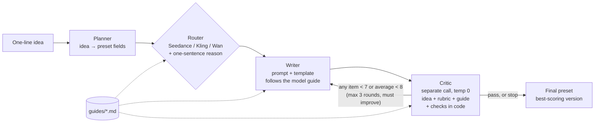

# Video Preset Agent

Type a one-line video idea, and the agent turns it into a ready-to-use prompt for the video model that fits it best (Seedance, Kling or Wan), plus a reusable `{subject}` template. A separate critic scores every draft against a rubric and the model's prompting guide, and the code forces rewrites until the prompt is good.

> **Demo video (60 s):** _placeholder — link coming soon_

A prototype built in a day to learn agent design. It is not used in production.

Model versions updated: 27 Nov 2026 (Seedance 2.5, Kling 4.0, Wan 3.0).

## How it works

The pattern is **routing + evaluator-optimizer**, from Anthropic's *Building effective agents*.



| Step | What it does |
|---|---|
| **Planner** | Parses the idea into fields: subject, one motion arc from start to end with counts ("jumps, does one flip, lands"), shot size, one simple camera move, environment, lighting + mood, one short style, duration, aspect ratio. Every beat of the idea is kept. |
| **Router** | Picks the target model from `guides/` and gives a one-sentence reason. "From my testing" rules come first: people go to Seedance; scenes without people in close-up go to Kling; Wan is the cheap option. You can override it in the UI. |
| **Writer** | Writes the prompt following the chosen model's guide, plus a template with a `{subject}` slot. It writes plainly: the full action first, one camera move, no stacked effects, no praise words, and under 60 words for fast body motion. |
| **Critic** | A separate call at temperature 0. It sees only the user's idea, the prompt, the guide and the rubric, never the writer's reasoning. It scores 9 rubric items from 1 to 10 and lists issues with fixes. From round 2 on, it also gets every issue it found earlier and answers *resolved: yes/no* for each one. |
| **Checks in code** | Deterministic checks that do not depend on the LLM: word count, vague praise words, a repeatable move without a count ("flips" instead of "one flip"), and fast body motion above 60 words. Each one caps its rubric item at 6. |
| **Loop (code)** | The code decides, based on the scores: if any item is below 7 or the average is below 8, it asks for a revision. It runs at most 3 rounds and stops early if the score did not improve. The final result is the **best** version, not the last one. |

Rubric: faithful to the idea (no beat dropped) · one clear motion arc with start and end · explicit shot size and one simple camera move · concrete subject (no vague adjectives) · lighting and mood stated · follows the model guide · no contradictions · motion physically plausible within the duration · simple and clear (no stacked effects).

## Run it

Requires Python 3.9+ and the standard library only. Nothing to install.

```bash
echo "OPENROUTER_API_KEY=sk-or-..." > .env     # or export OPENROUTER_API_KEY
python3 app.py                                 # then open http://localhost:8000
```

- **CLI:** `python3 agent.py "fog rolling over a pine forest at dawn" [--model auto|seedance|kling|wan]`
- **Replay:** every run is saved to `runs/<timestamp>.json`. The *Replay* dropdown plays a saved run step by step without an API call, so the demo also works offline.
- **Critic calibration:** `python3 tests/critic_calibration.py`
- **LLM:** `google/gemini-3.5-flash-lite` via OpenRouter, set in one constant (`MODEL` in `agent.py`). It is fast, cheap, returns reliable JSON and supports `temperature`, which the critic needs at 0. It replaced `gemini-3.1-flash-lite` after the harder calibration set: 42/42 checks passed vs 25/28, at about the same cost per call and twice the speed.

## Example (saved run)

**Raw idea:** `a parkour runner jumps between rooftops at sunset, flips and lands`

**Planner action:** runs to the edge of a concrete rooftop, jumps the gap, does **one** front flip, **lands** firmly on both feet.

**Router:** Seedance 2.5, because a person's body motion is the subject.

**Round 1, critic 8.7 (REVISE):** 84 words for fast body motion (a code check caps *simple & clear* at 6), and the praise word "dramatic" (another code check caps *concrete subject* at 6).

**Round 2, critic 10.0 (PASS):** 59 words.

> A parkour runner wearing dark clothing and red sneakers runs to the edge of a concrete rooftop, jumps the gap, does one front flip, and lands firmly on both feet on the opposite roof. Medium wide shot, steady tracking camera. Urban city rooftops at sunset. Low sun casting long hard shadows, glowing orange sky, energetic mood. Realistic, natural colors.

**Template:** `{subject} runs to the edge of a concrete rooftop, jumps the gap, does one front flip, and lands firmly on both feet …`

## Cost and latency

From the 5 saved demo runs (person close-up, product, landscape, action, food):

| | min | typical | max |
|---|---|---|---|
| Time per run | 6.5 s | ~9 s | 10 s |
| Estimated cost per run | $0.0035 | ~$0.006 | $0.006 |

Four of the five runs needed one revision; the food shot passed on the first try. A run uses about 8–12k input tokens and 0.5–1k output tokens. A full 3-round run takes about 15 s and $0.009. Cost is estimated from token counts and list prices. The whole project, including development, testing, model comparisons and several re-recordings of the demos, cost about $0.82 in API calls.

## Critic calibration

`tests/critic_calibration.py` runs the critic on 4 known-bad prompts and 3 known-good prompts. A bad prompt must score below 7 on a rubric item it breaks, so that the loop forces a revision. A good prompt must average 8 or more with every item at 7 or more. The *overloaded action* case is a real prompt that once scored 10/10 and then failed on a real generation (see below).

| Case | Model | Item that must fail | Score | Average | Result |
|---|---|---|---|---|---|
| bad: vague words | Kling | concrete subject | 3 | 5.8 | OK |
| bad: two actions | Seedance | one action | 4 | 7.4 | OK |
| bad: camera contradiction | Kling | shot & camera | 6 | 8.0 | OK |
| bad: overloaded action (real) | Seedance | simple & clear | 6 | 7.8 | OK |
| good: person close-up | Seedance | all ≥ 7 | min 10 | 10.0 | OK |
| good: product shot | Kling | all ≥ 7 | min 10 | 10.0 | OK |
| good: simple action | Seedance | all ≥ 7 | min 10 | 10.0 | OK |

Even at temperature 0 the critic is not fully deterministic, because it uses light reasoning. With the current model it passed 42 of 42 repeated checks; the previous model failed about 1 in 8.

## What I learned

The first critic was far too generous: it gave **10/10** to a prompt containing "cinematic, high-definition", words its own guide says to avoid. Here is what fixed it, step by step:

1. **Issues first, scores second.** The JSON key order is `issues → fixes → scores`, so the model audits before it judges. Before this change it named three problems and still passed the prompt.
2. **The code counts words.** The critic gets the word count from code instead of estimating length itself, which an LLM does badly.
3. **Cap of 6 for a guide violation, enforced in code.** Asking the model to cap its own score did not work: it said "banned word" and still scored 7. Now the critic must quote the broken rule word for word, the code checks that the quote really appears in the guide, and then the code caps that item at 6. This also blocked hallucinated "rules": once the critic claimed a mood word was banned.
4. **The code computes the total and the verdict.** The LLM never does arithmetic and never decides alone whether to stop.
5. **Resolved checks across rounds.** In one run the critic flagged a flip as too complex, and the flip survived the rewrite unnoticed. Now every earlier issue is re-checked (*resolved yes/no*), and an unresolved one caps its item at 6. This check also caught a regression: the writer brought back "handheld shake" after fixing it one round earlier. The writer now also gets a "do not bring these back" list.
6. **Calibrate on bad and good examples.** The calibration set caught a mistake in my own "good" example ("lowers her umbrella *and* looks up" really is two actions). All three models I tried flagged it, so the critic was right. It also led me to define the rubric more precisely: a simultaneous expression or ambient motion (steam, hair in the wind) is not a second action, but sequential actions are.
7. **Watch what your own critic prompt suggests.** One example in the critic prompt, "known weaknesses (e.g. faces in close-up)", kept lowering scores for Seedance close-ups, even though faces are Seedance's strength. The critic now uses only the weaknesses listed in the current model's guide.

8. **A 10/10 prompt lost to the raw idea on a real generation.** On Seedance 2.5 flash, the plain idea *"a parkour runner jumps between rooftops at sunset, flips and lands"* gave a clean single flip. An agent prompt that scored 10/10 gave a double flip, and the runner's head vanished for a moment as if he teleported. Kling 4.0 Flash was not clearly better. The reasons:
   - The planner had cut "and lands", so the motion had no end and the model invented one.
   - The prompt stacked demands on fast motion: tracking shot, handheld shake, lens flare, film grain.
   - The rubric rewarded completeness, not simplicity or faithfulness.

   The fixes:
   - The rubric gained *faithful to idea* and *simple & clear*.
   - The planner now writes the whole motion arc with counts, and the writer is told to write plainly.
   - Four checks moved into code: praise words, a move without a count, fast motion over 60 words, and the word count.
   - That exact prompt is now a "bad" calibration case.

   The lesson: **critic scores must be checked against real generations.**
9. **A stronger, cheaper judge mattered once the test got harder.** On the first calibration set, swapping models made no difference. On the harder set, the old model kept penalising a correct "jump, one flip, land" as "too many actions", even while quoting the rule that says it is one arc. Gemini 3.5 Flash Lite passed every repeated check.

## Limitations

- **LLM-as-judge bias.** The writer and critic are the same model family, so the critic may share the writer's blind spots and favour its style. Scores are noisy near the thresholds.
- **Scores are not ground truth.** A 10/10 means the prompt follows the rubric and guide, not that the video will look good. One real test (above) showed a 10/10 prompt losing to the raw idea. The rules added after it are based on a single test, so they are marked unverified in the guides.
- **The critic still misses things.** It can let a small change of meaning through, for example "reads a letter" becoming "holds a letter". The code checks catch only the patterns they were written for.
- **Guides go stale.** Video models change every few months. The guides in `guides/` were researched in November 2026, and anything uncertain is marked "unverified".
- **Small scope.** The agent handles text-to-video for single clips only. It does not cover image-to-video, multi-shot sequences or reference images.

## Next steps

- **Keyframe image step:** generate the background first, then the character on that background, then the video (my consistency approach).
- **Vision QA:** score frames from the actual generated video, not just the prompt.
- **A/B tests with real generations:** check whether higher critic scores actually produce better videos, and recalibrate the rubric from that.

## Files

```
agent.py                      Planner, Router, Writer, Critic, loop, CLI
app.py                        http.server + Server-Sent Events + replay API
static/index.html             single-page UI (no frameworks, no CDNs)
guides/{seedance,kling,wan}.md  model prompting guides with sources
tests/critic_calibration.py   known-bad / known-good critic check
runs/                         saved runs (used by Replay)
```
