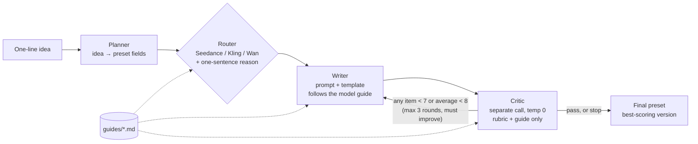

# Video Preset Agent

Type a one-line video idea, and the agent turns it into a ready-to-use prompt for the video model that fits it best (Seedance, Kling or Wan), plus a reusable `{subject}` template. A separate critic scores every draft against a rubric and the model's prompting guide, and the code forces rewrites until the prompt is good.

> **Demo video (60 s):** _placeholder — link coming soon_

A prototype built in a day to learn agent design. It is not used in production.

## How it works

The pattern is **routing + evaluator-optimizer**, from Anthropic's *Building effective agents*.



| Step | What it does |
|---|---|
| **Planner** | Parses the idea into fields: subject, exactly one action, shot size, camera motion, environment, lighting + mood, style, duration, aspect ratio. |
| **Router** | Picks the target model from `guides/` and gives a one-sentence reason. "From my testing" rules come first: people go to Seedance; scenes without people in close-up go to Kling; Wan is the cheap option. You can override it in the UI. |
| **Writer** | Writes the prompt following the chosen model's guide (structure, length, camera vocabulary, things to avoid), plus a template with a `{subject}` slot. |
| **Critic** | A separate call at temperature 0. It sees only the prompt, the guide and the rubric, never the writer's reasoning. It scores 7 rubric items from 1 to 10 and lists issues with fixes. From round 2 on, it also gets every issue it found earlier and answers *resolved: yes/no* for each one. |
| **Loop (code)** | The code decides, based on the scores: if any item is below 7 or the average is below 8, it asks for a revision. It runs at most 3 rounds and stops early if the score did not improve. The final result is the **best** version, not the last one. |

Rubric: one clear action per clip · explicit shot size and camera motion · concrete subject (no vague adjectives) · lighting and mood stated · follows the model guide · no contradictions · motion physically plausible within the duration.

## Run it

Requires Python 3.9+ and the standard library only. Nothing to install.

```bash
echo "OPENROUTER_API_KEY=sk-or-..." > .env     # or export OPENROUTER_API_KEY
python3 app.py                                 # then open http://localhost:8000
```

- **CLI:** `python3 agent.py "fog rolling over a pine forest at dawn" [--model auto|seedance|kling|wan]`
- **Replay:** every run is saved to `runs/<timestamp>.json`. The *Replay* dropdown plays a saved run step by step without an API call, so the demo also works offline.
- **Critic calibration:** `python3 tests/critic_calibration.py`
- **LLM:** `google/gemini-3.1-flash-lite` via OpenRouter, set in one constant (`MODEL` in `agent.py`). I picked it because it is fast, cheap, has reliable JSON output, and supports `temperature`, which the critic needs at 0. Cheaper models on OpenRouter did not expose temperature.

## Example (saved run)

**Raw idea:** `a parkour runner jumps between rooftops at sunset, flips and lands`

**Router:** Seedance 2.5. The subject is a person doing complex body movement, which is Seedance's strength.

**Round 1, critic 8.1 (REVISE):** *one action 7 · concrete subject 6 · plausible motion 6*
- "High-speed action photography" is a vague style word; this breaks a guide rule, so the item is capped at 6.
- A flip during a rooftop gap jump is too much for one 6-second clip, so the motion is likely to fragment.

**Round 2, critic 10.0 (PASS):** both earlier issues are marked resolved.

> An athletic parkour runner in a black techwear hoodie and grey cargo pants jumps across a gap between two concrete apartment rooftops at dusk with distant skyscrapers. Medium long shot, camera tracking pan follows the subject through the leap. Golden hour backlighting creates long orange shadows and lens flare. The background shows subtle motion blur while the subject remains in crisp focus, 35mm film grain. AMBIENCE: wind whooshing, distant city traffic. Avoid: text, logos, slow motion.

**Template:** `{subject} jumps across a gap between two concrete apartment rooftops at dusk …`

## Cost and latency

From the 5 saved demo runs (person close-up, product, landscape, action, food):

| | min | typical | max |
|---|---|---|---|
| Time per run | 13 s | ~17 s | 25 s (3 rounds) |
| Estimated cost per run | $0.004 | ~$0.006 | $0.010 |

That is about 6–13k input tokens and 1–4k output tokens per run. The cost is estimated from token counts and list prices. The whole project, including development, testing and model comparisons, cost about $0.20 in API calls.

## Critic calibration

`tests/critic_calibration.py` runs the critic on 3 known-bad prompts and 2 known-good prompts. A bad prompt must score below 7 on the rubric item it breaks, so that the loop forces a revision. A good prompt must average 8 or more with every item at 7 or more.

| Case | Model | Item that must fail | Score | Average | Result |
|---|---|---|---|---|---|
| bad: vague words | Kling | concrete subject | 2 | 6.3 | OK |
| bad: two actions | Seedance | one action | 4 | 7.7 | OK |
| bad: camera contradiction | Kling | no contradictions | 4 | 7.1 | OK |
| good: person close-up | Seedance | all ≥ 7 | min 10 | 10.0 | OK |
| good: product shot | Kling | all ≥ 7 | min 10 | 10.0 | OK |

Even at temperature 0 the critic is not fully deterministic (it uses light reasoning). In repeated runs, a good prompt occasionally gets one item scored 6, roughly 1 run in 6–8.

## What I learned

The first critic was far too generous: it gave **10/10** to a prompt containing "cinematic, high-definition", words its own guide says to avoid. Here is what fixed it, step by step:

1. **Issues first, scores second.** The JSON key order is `issues → fixes → scores`, so the model audits before it judges. Before this change it named three problems and still passed the prompt.
2. **The code counts words.** The critic gets the word count from code instead of estimating length itself, which an LLM does badly.
3. **Cap of 6 for a guide violation, enforced in code.** Asking the model to cap its own score did not work: it said "banned word" and still scored 7. Now the critic must quote the broken rule word for word, the code checks that the quote really appears in the guide, and then the code caps that item at 6. This also blocked hallucinated "rules": once the critic claimed a mood word was banned.
4. **The code computes the total and the verdict.** The LLM never does arithmetic and never decides alone whether to stop.
5. **Resolved checks across rounds.** In one run the critic flagged a flip as too complex, and the flip survived the rewrite unnoticed. Now every earlier issue is re-checked (*resolved yes/no*), and an unresolved one caps its item at 6. This check also caught a regression: the writer brought back "handheld shake" after fixing it one round earlier. The writer now also gets a "do not bring these back" list.
6. **Calibrate on bad and good examples.** The calibration set caught a mistake in my own "good" example ("lowers her umbrella *and* looks up" really is two actions). All three models I tried flagged it, so the critic was right. It also led me to define the rubric more precisely: a simultaneous expression or ambient motion (steam, hair in the wind) is not a second action, but sequential actions are.

I also tried swapping the critic model. DeepSeek V4 Flash and Gemini 3.5 Flash Lite were no more accurate on the calibration set, and DeepSeek was about 10× slower. The prompt and code changes mattered more than the model.

## Limitations

- **LLM-as-judge bias.** The writer and critic are the same model family, so the critic may share the writer's blind spots and favour its style. Scores are noisy near the thresholds.
- **Scores are not ground truth.** A 10/10 means the prompt follows the rubric and guide, not that the generated video will look good. No video was generated to check this.
- **Guides go stale.** Video models change every few months. The guides in `guides/` were researched in November 2026, and anything uncertain is marked "unverified".
- **Small scope.** The agent handles text-to-video for single clips only. It does not cover image-to-video, multi-shot sequences or reference images.

## Next steps

- **Keyframe image step:** generate the background first, then the character on that background, then the video (my consistency approach).
- **Vision QA:** score frames from the actual generated video, not just the prompt.
- **A/B tests with real generations:** check whether higher critic scores actually produce better videos, and recalibrate the rubric from that.

## Files

```
agent.py                      Planner, Router, Writer, Critic, loop, CLI
app.py                        http.server + Server-Sent Events + replay API
static/index.html             single-page UI (no frameworks, no CDNs)
guides/{seedance,kling,wan}.md  model prompting guides with sources
tests/critic_calibration.py   known-bad / known-good critic check
runs/                         saved runs (used by Replay)
```
